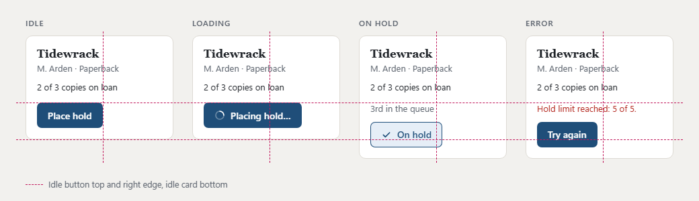
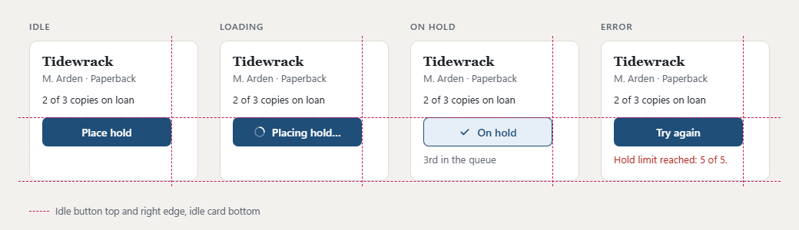

# Design Foundations

Use this reference to turn an accepted architecture and art direction into a coherent visual system. Foundations are role contracts, not universal recipes: an existing verified system is the baseline in evolution work, and new work derives tokens from real content, platform, perception and behavior.

## Starting Points

These are defaults to start from and then beat. Deviate when content, brand, platform or an accepted system gives a reason, and record it. An existing system's values come first.

**Typography**
- Family choice, count and pairing follow the [font-pairing method](art-direction-gate.md#typographic-voice-and-font-pairing).
- Body text 16 px on the web (14–15 px in dense apps). Line height 1.4–1.6 for body, 1.1–1.25 for headings.
- Measure 45–75 characters (`max-width: 65ch` for reading text).
- Scale ratio about 1.2–1.25 between steps in apps, 1.25–1.5 in editorial and marketing work.
- Two weights (regular plus semibold or bold) usually carry the hierarchy.
- Tighten large display type slightly (−0.01 to −0.03em). Loosen small all-caps labels (+0.04 to +0.08em).
- `text-wrap: balance` on headings, `text-wrap: pretty` on paragraphs. `font-display: swap`, preload the critical face, and match fallback metrics with `size-adjust` to limit shift.

**Spacing and layout**
- One base unit (4 or 8 px) and a short scale built from it.
- Space inside a group is smaller than space between groups, so proximity shows what belongs together.
- Reading columns cap near 65ch. App work areas use the available width, while forms cap near 640 px.
- Few alignment axes; break one only to create a deliberate focal point.

**Color**
- Tint neutrals slightly toward the brand hue instead of pure gray.
- Build ramps in OKLCH so steps look evenly spaced.
- One accent for primary actions and selection. Status colors (success, warning, danger, info) are separate from the accent.
- Keep the accent's area small unless the brand leads the page. Check text on the accent for 4.5:1.

**Dark theme**
- Base surface off-black (roughly 6–10% lightness), with elevated surfaces lighter rather than shadowed.
- Body text softened from pure white. Accents slightly less saturated than in light mode.
- Recheck every contrast pair; never just invert the light palette.

**Elevation and edges**
- Two or three elevation levels: base, raised, overlay.
- Shadows are layered (a small sharp one plus a large soft one) at low opacity.
- Nested radius equals the outer radius minus the padding.
- In dense interfaces, separate with 1 px low-contrast borders or tone steps rather than shadows.

**States and focus**
- Hover is a subtle tint; pressed is a step darker.
- `:focus-visible` shows a 2 px outline with a 2 px offset at 3:1 or better against its surroundings.
- Disabled has reduced but legible contrast. Selected changes fill or weight, and sets the ARIA state.

**Forms**
- Labels above fields, one column, field width hinting at the expected length.
- Mark whichever of required or optional is the minority.
- Validate on blur and on submit, not on every keystroke. Put the error text under its field with an icon, and add a summary at the top of long forms.
- Use `autocomplete`, `inputmode` and the correct `type`. Keep entered data after an error.
- The primary action sits at the end, aligned with the fields.

**Data tables**
- Numbers right-aligned with tabular figures; text left-aligned; each header aligned like its column.
- Units in the header rather than every cell; consistent decimal places.
- Rows of roughly 36–44 px when dense, 48–56 px when comfortable. Sticky header on long tables.
- Truncate only secondary columns, with a way to read the full value. Use zebra stripes or dividers, not both.

## Composition and Hierarchy

- Define the attention order for each important viewport and state.
- Begin with content relationships and task sequence; choose grid and breakpoints after the composition exists. Use the base-unit scaffold by default and derive another when content, brand, platform or interaction needs it.
- Use scale, proportion, alignment, rhythm, spacing, contrast, image and content relationships, and disclosure before containers. Equal boxes give equal weight even to unequal content.
- Whitespace is structure: use dividers, tonal change or type hierarchy before cards when content is not an independent object or action.
- A monitoring, comparison, editing or creative workspace may need coordinated peer regions instead of one focal point; the task decides.
- Marketing and editorial rhythm can come from content density, media, type, alignment or interaction, not a forced alternation of identical sections.
- Use intrinsic sizing, flex and grid, container queries, `min()`, `max()` and `clamp()` where they add resilience.
- Define invariants and transformation rules for order, navigation, disclosure, comparison, imagery, sticky behavior and input mode ([responsive checks](quality-gates.md#responsive-transformation)). Keep readable measure for sustained text, scan alignment for dense data and spatial relationships for comparison.

## Density Before Dimensions

Before choosing heights, padding and headline sizes, establish how the surface is used (reading and persuasion, occasional choice, or repeated monitoring and editing), the input mode, typical content volume and which decisions must be seen together, from behavior and product evidence rather than a category keyword. Keep a compact contract, `task/frequency → content states → information/actions visible together → existing comparable roles → fixed chrome versus working region → proof`, and reuse an accepted density system when it fits.

Size content and grouping first, then distribute the remaining space. A wider viewport does not justify larger padding, navigation rows or status values. Minimum heights, repeated section padding, viewport-sized wrappers and flex or grid stretching accumulate even when each number looks reasonable; measure their combined effect on the first useful decision.

Treat empty, sparse and populated content as distinct compositions: an unassigned value or zero count keeps its factual role instead of the emphasis of a real result. Page-level content such as a document or list may use its natural extent up to its scroll owner, while the frame around it (shell, panels, dialogs, tab panels, grid cards, toolbars, buttons) keeps its size across states ([stable geometry](#stable-geometry-across-states)). Avoid giant empty wells.

Default to the tightest composition that keeps readable type, usable hit regions, grouping, keyboard focus, localization and touch behavior. When density is open on a new or revised repeated-use surface, compare it with a credible tighter composition on identical empty, short and long content, judging useful information visible together, distance between related facts and actions, and scanning effort. A spacious editorial or reference design can be the right exception; record why the chosen density fits. Fix excess at its cause in the owning layout (additive padding, min-height, stretching, type role or state treatment), never with global zoom, a CSS scale transform, shrinking all fonts or clipping: small labels and targets may already be right while their containers are too large. Recheck that long lists still scroll in their region and that short states do not inherit unused height.

## Placement and Alignment

Choose the reference frame before aligning: content column, control, panel, visual group or viewport; a sidebar or asymmetric padding can make viewport centering wrong for the usable region. State whether the role needs edge alignment, a text baseline, the geometric center, the optical center or a deliberate offset, and inspect the real box, padding and visible mass; `align-items:center` alone does not prove balance.

Place actions near the object and decision they affect, group related labels, values and controls, and give repeated peers consistent axes. Compare a credible alternative when placement is open. Default: long reading text, lists and numeric columns align to their start edge; keep an offset only for a reason. In mixed control rows, align the visible inputs and buttons, not the wrappers that hold their captions ([incident](failure-patterns.md#a-field-caption-that-pushed-its-input-off-the-row-axis)).

## Stable Geometry Across States

A control the user is about to press must not move, and a panel must not change size because its content changed. Size every frame element for the largest state it must hold, or reserve the slot that a state will fill. States to cover: loading, loaded, empty and error; selection and deselection; tab switches; hover, focus and pressed; label changes such as "Save" to "Saving…"; validation messages; live updates; late images and fonts.

Techniques:
- Dialogs, side panels and inspectors get a fixed width per type. Their content scrolls inside while the header and actions stay put.
- Tab panels and stepper bodies get a `min-height` taken from their tallest panel, or they share one scroll owner.
- Reserve the line for a validation or status message (`min-height`), or place the message where its appearance cannot push the submit control.
- Buttons whose label or icon changes keep their width: give them a `min-width` sized to the longest label, or overlay the spinner without removing the label from layout.
- Hover, selected and bold states do not change box size. Use color, background or a pseudo-element outline instead of weight or border-width changes that shift neighbors.
- Skeletons and placeholders match the final geometry: same row count or height, same column widths.
- Changing numbers use `font-variant-numeric: tabular-nums`, and their containers get a width for the longest expected value.
- Images and media declare `width` and `height` or `aspect-ratio`. Scrollable regions that can gain a scrollbar use `scrollbar-gutter: stable`.
- New content appears where it cannot push the user's current focus: below it, in a reserved region, or as an announced update.

Intentional resizing is fine when the user asked for it, for example expanding a disclosure or dragging a splitter. Prove stability by comparing the bounding boxes of the frame regions and the active control in state A and state B at the same viewport. Unrequested movement is a defect.

**Shifting:** against the dashed idle edges, the loading button grows wider, and the on-hold and error messages push the button down and the card taller.

**Reserved:** a fixed-width button and a reserved message line below it keep every edge on the guides in all four states.

## Bounded Lists and Scroll Ownership

Decide which surface owns scrolling. A document page may grow; a list inside a height-bounded dialog, dashboard panel or persistent workspace scrolls in its own region with its heading and actions reachable. Set the parent height or max-height and the shrinking chain, `min-height:0` on the relevant flex or grid children, and `overflow:auto` on the list owner. Never hide rows, shrink text or put overflow on an unrelated ancestor to disguise the failure.

Check long, empty and loading lists, keyboard focus and scrolling, and narrow touch layouts. A scroll region needs a useful accessible name and keyboard reachability when its contents have no native focusable items. Keep focused items visible and avoid nested scroll traps. At a mobile breakpoint, choose internal scrolling or a coherent page-flow transformation deliberately instead of inheriting an unbounded desktop panel.

## Typography

Choose type from language, content, role, metrics and voice. This section owns the role contract; the [pairing method](art-direction-gate.md#typographic-voice-and-font-pairing) owns family count, pairing, x-height, script coverage and fallback stacks, and [typography coherence](quality-gates.md#typography-coherence) owns rendered verification.

Inventory required scripts, locales, diacritics, bidirectionality and fallback paths; headings, body, navigation, labels, validation, prices, currencies, dates, units, tables, code and identifiers; the longest realistic strings, shortest labels, user-generated content and missing-glyph behavior; and the actual font files, license, weights, axes, subsets, loading and synthetic styles.

Define roles before family names, and keep a compact role map in the existing record: `role → family stack → real weights/styles/axes → size/line-height/tracking → scripts → owner → exception`. Start from the accepted system. Default: the primary text family carries body, navigation, labels and controls, and hierarchy comes from size, real weight, spacing and placement rather than a new family per section; an extra family must earn a semantic or brand role. Prices can usually align with tabular figures in the existing family. Keep an accepted display face, code face, logotype and legitimate script-specific fallback.

Fix assignments at the shared typography token, inheritance, reset or component variant, not with per-occurrence overrides; reused library components can import a different stack. Make native controls inherit the relevant role without forcing every element to the body font and erasing display, code, icon-font or locale roles.

Use fluid size where it preserves hierarchy, not as spectacle. Avoid very light small text, use tabular figures where alignment carries meaning, and allow zoom and system text scaling without clipping or content loss.

## Color and Material

Start from semantic and perceptual roles: canvas, surface, raised and overlay, foreground, muted, border; primary and secondary actions with their foregrounds; focus, selection, hover, pressed, disabled; success, warning, danger, information and domain states; data series, annotations, imagery interaction and brand expression.

Set a positive direction from the product, accepted references and brand values, real content and task: name what the palette should communicate and why it belongs here before choosing a hue family. "Not gray", "more saturated", a style adjective or an attractive swatch set is not a rationale, and an internally harmonious palette can still be wrong for the product.

Own the color decision; it is reversible. Before writing theme CSS, synthesize the complete role palette and name any material uncertainty. When comparison is needed, render credible alternatives on real content, including repeated data and an overlay, and select the strongest yourself. Do not make the user supply hex values, choose among unfinished skins or diagnose avoidable palette failures; ask only when unresolved brand or business constraints would change the direction. Present the selected, reviewed result unless alternatives were requested. A familiar palette can be right; originality is not the criterion.

Choose hue, chroma, lightness and painted area separately, and compare intensity candidates on the same content when intensity is open ([incident](failure-patterns.md#accents-that-kept-collapsing-to-pale-tints)).

Resolve the complete affected palette: canvas, panels, table header, body and hover, dialogs, fields, controls, type and states. Trace final paint through library defaults, hard-coded owners, ancestors, pseudo-elements, filters, blend modes, backdrops and portals, over representative content in each theme; a token change that misses a portal or table header is incomplete. Default: neutrals carry most surfaces and color marks roles; distinguish layers through hue, temperature, lightness, chroma and area rather than tinting every panel or giving each component an unrelated fill. Deliberate neutral or pastel palettes stay valid when justified or approved.

Separate action fill, on-color text, accent foreground, subtle surface, focus and status roles: a foreground that reads on a dark canvas is not automatically a good button fill. Solve contrast in the actual foreground and background pair, with role-specific lightness or a suitable on-color foreground, instead of washing out the palette, and check hover, pressed, selected and focus states with any opacity, overlay, filter or disabled inheritance.

Judge full renders, including a data region and an open overlay when in scope, for product fit and visual mass as well as harmony and contrast: large saturated surfaces can impose an unrelated identity or pull attention from the data. Reject an unsupported or user-rejected direction even when its tokens pass contrast.

Material is broader than shadow and blur: edge, join, density, layering, texture, line, transparency, image treatment and state response. Define a small semantic elevation model when layers exist.

## Shape and Edge Language

Shape follows behavior, the visual thesis, platform, content and hierarchy. Default: define edges by role (small detail, control, container, overlay, image, semantic token, circular object) and keep hit targets independent of visible geometry. Sharp, rounded, irregular, cut, framed or borderless systems all work when coherent and usable. A repeated edge can carry identity with a product reason and a repetition boundary; one global radius dial is not a system. Check nested surfaces, text fit, focus, selected, disabled and error states together.

Use a pill for compact selection or removal, a meaningful token, or verified brand or native behavior. A short string alone is not a token: metadata, eyebrows, navigation links, fields and calls to action do not inherit a capsule from a nearby filter. Use a circle where the silhouette communicates the object or action. In a new or revised shape system, keep interactive controls, selected tokens, passive status and plain content distinguishable even when they share curvature. Compare a disputed capsule with unwrapped text, a bounded control or another role-appropriate treatment on the same content; keep it when it improves recognition, state reading or established identity, and otherwise remove the wrapper and rebalance spacing and type. A shape swap alone does not repair hierarchy ([incident](failure-patterns.md#pills-replaced-with-square-buttons)).

## Surfaces and Containers

- A card is justified when content behaves as an independent, selectable, movable, comparable, purchasable or actionable unit; ordinary sections usually need only alignment, spacing, type or a divider.
- Use card-in-card only when the object hierarchy is real and legible.
- Use shadow, border, tone, texture, blur or overlap to explain layers or interaction; remove them when they only decorate.
- Hover lift belongs only on interactive surfaces.

## Controls and Components

Choose components by behavior and platform semantics, then style them within the direction.

- Links navigate; buttons act.
- Form fields keep persistent labels; placeholders are supplemental.
- Keep native or repository primitives when they meet the task. Custom controls reproduce keyboard, focus, selected, disabled, validation, text scaling and assistive-technology behavior.
- Visible control scale follows density, content, input mode and brand; the hit target can grow through transparent non-overlapping space.
- Full-width, oversized, icon-only, segmented or chip treatments need a behavioral reason. Choose icon-only, text-only or icon-with-text with the [label-mode rules](iconography-system.md#choose-the-control-label-mode); a known utility needs no new icon sourcing.
- Choose where each task lives with [surfaces-and-disclosure.md](surfaces-and-disclosure.md); keeping everything on one surface needs a reason as much as moving it off.

For a button family, resolve visible height, content width, padding, label metrics, icon size and gap, edge treatment and alignment from the accepted reference or system, or from local density and task. Importance can come from placement and contrast instead of a taller, wider button, so a toolbar action, an inline action and a campaign CTA need not share one size. Removing pills does not authorize square corners ([incident](failure-patterns.md#pills-replaced-with-square-buttons)).

Compare controls at rendered size beside nearby fields, tabs, text and secondary actions, including narrow and long-label states. Reject a size or shape change that departs from the target, dominates content without a task benefit, breaks its family's density or alignment, or squeezes essential neighbors. Trace unexpected size or corners to the owner (inherited font or line-height, size variant, min-height, padding, flex stretch, global radius utility, box sizing) and fix that cause instead of overriding every button. Keep the visual box distinct from a larger non-overlapping hit region; enlarging a target must not inflate the visible control or steal neighboring targets.

## Icons, Imagery and Motion

Open their references only while the decision is active. [iconography-system.md](iconography-system.md) covers icon source, family, label mode and custom drawing: familiar actions stay recognizable, and product and domain symbols can become more ownable while metaphor and rendering stay clear. [imagery-and-assets.md](imagery-and-assets.md) gives each visual a job and treatment and stops after a justified no-image choice. [motion-and-interaction.md](motion-and-interaction.md) starts from defined states and the static, reduced experience, and opens only when motion is a decision or a defect.

## System Coherence

Coherence is not uniformity; it means roles and exceptions are understandable. Type roles share a hierarchy even when display differs from utility text; icon sources have stable roles and compatible rendered weight; product imagery can be rich while routine chrome stays quiet; marketing motion can be expressive while frequent controls stay immediate; one page family can be dense and another spacious while both share product logic. Document the role boundary rather than forcing one token, package or treatment everywhere.
