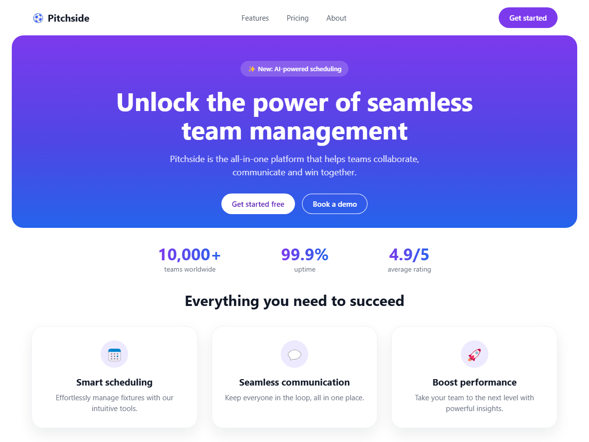
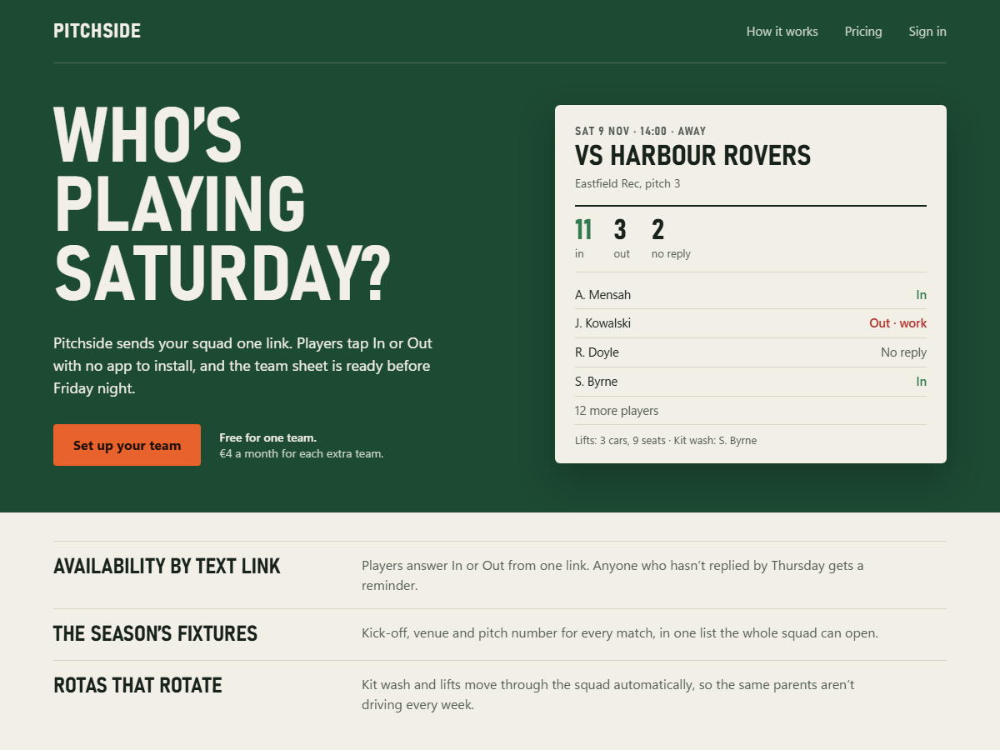
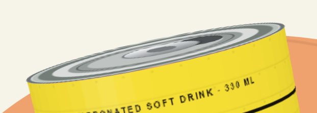

# Failure Patterns

Use before accepting an original visual design, and whenever a result looks generic, templated, "AI-made" or dated. Each pattern is a symptom to inspect in the render, not a ban: apply the replacement or record why this product is the exception. Fewer patterns alone do not make a design good; pair this check with a positive direction from [art-direction-gate.md](art-direction-gate.md).

## Generic Output

AI slop is not a modern look. It is the median page nobody decided: framework defaults left untuned, decoration standing in for the product, copy and proof that would fit any company, effects stacked without a reason, and uneven execution. A category's current conventions, such as a well-set sans family, a centered launch hero, pill buttons, one small tag above the headline or fine frame lines on the canvas, are its living vernacular. Judge them by precision and fit, never by presence. Running from them for distinctiveness alone produces a dated or eccentric page, which fails as surely ([dated output](#dated-output)).

| Symptom | Usual cause | What to check | Constructive replacement | Legitimate when |
|---|---|---|---|---|
| Framework defaults left as found: stock grays, `rounded-xl` cards with `shadow-lg`, indigo or violet primary buttons, default focus rings | No value was chosen | Can each color, radius and shadow name the decision behind it? | Role tokens derived from the direction ([tokens](art-direction-gate.md#translate-the-direction-into-tokens)) | An accepted design system ships those values |
| Purple-to-blue gradient hero, gradient headline text | Model default for "modern" | Does the hue come from the product, brand or content? | A palette from product evidence: one accent with a clear role, neutrals tinted toward it | The verified brand uses that gradient |
| Gradient, glow, glass and shadow stacked on one element | Adding effects instead of deciding | Which single treatment carries the element's role? | One treatment per role; remove the rest and compare | A signature surface whose material is the move |
| Headings, body, labels and data at one size and weight | No type decision | Do the roles read as different at a glance? | Assign type roles; hierarchy through size, weight and tracking within one family; a display face only for a role the family cannot carry | — |
| Display type at the text face's default tracking and leading | Type enlarged, not set | Does the headline look set or merely scaled up? | Tighten tracking and leading for display sizes, judged on the real words | A face drawn for display at its default settings |
| Every block in a card, often in a uniform grid | Container-first layout | Is each item an independent object or action? | Group with proximity, alignment, dividers and type; cards for independent, comparable objects | A collection of peer objects (products, files, people) |
| The template sequence whatever the offer: hero, three identical feature cards, CTA | Landing-page template | Does the order follow the visitor's decision, and does each block show something different? | Map the page first; lead with the offer and its proof; shape each block by what it must show | — |
| Icon in a tinted circle or tile above every feature | Decoration default | Does the icon add meaning the heading lacks? | Remove it, place a bare icon by its label, or use a real image or diagram | Platform app grids and launchers |
| Emoji as interface icons | Convenience | Is there a consistent icon family? | A family chosen with [iconography-system.md](iconography-system.md) | Casual user content such as reactions and chat |
| Pills around passive metadata and plain labels | Styling short strings | Is the capsule selectable, removable or a status? | Plain text with weight, color or position | Filters, removable tokens, status chips; pill buttons in a shape system that chose them |
| Uppercase tracked eyebrow above every heading | Template rhythm | Does it add orientation the heading lacks? | Remove it, or use a real category or breadcrumb | One tag naming a real release, category or audience, such as above the hero; editorial sections with a real taxonomy |
| Light gray body text (for example `#9ca3af` on white) | "Elegant" restraint | Is body contrast at least 4.5:1? | Darker text; hierarchy through size and weight | Disabled controls (exempt, but still legible) |
| Shadows or glows on most elements | Default depth | What is actually above what? | One or two elevation levels; siblings separated by borders or tone | Floating overlays: menus, dialogs, toasts |
| Glass panels with backdrop blur by default | Trend | Does content behind the panel matter to the task? | Solid surfaces with a clear tone step | Over media where context matters, with a contrast-safe scrim |
| Many accent colors, a rainbow of categories | Coloring everything | Which colors carry a role: action, status, data? | One accent plus semantic status colors; data colors from a validated palette | Charts that need categorical hues |
| Large radii on everything (24 px and up) | "Friendly" default | Do edges differ by role (control, container, overlay)? | Edge logic by role ([design-foundations.md](design-foundations.md#shape-and-edge-language)) | A verified soft brand language applied consistently |
| Decorative blobs, orbs or noise | Filling empty space | Would the page lose meaning without them? | Content, product imagery or deliberate whitespace | A brand motif with a defined role and boundary. Fine frame lines or a quiet grid aligned to the layout grid are a convention, not filler |
| Uneven execution: three radii, two icon families, gaps that drift, edges that almost align | Parts assembled without a system | Does each role use one value everywhere? | Role tokens and one icon family; fix the outliers, then rerender | — |
| Invented stats, testimonials, client logos ("10k+ teams") | Filler social proof | Is each claim supplied or verified? | Omit unverified proof; show real facts | Real data provided by the user |
| Generic marketing copy ("Unlock the power of…", "seamless") | Template language | Could the sentence describe any product? | Specific claims from product facts, in the audience's words | — |
| A landing page that reads like a document: paragraphs and bullet lists in every section, well over 1,200 words of prose | Explaining instead of showing; nothing cut | From headings, hero sentences and visual labels alone, can a visitor say what it is, for whom, why to believe it and what to do next? | One idea per section within the [copy budget](page-hierarchy.md#keep-marketing-copy-scannable); a visual in place of each descriptive paragraph; depth into FAQ disclosures or deeper pages | Long-form editorial, documentation, required disclosures |
| One visual type down the whole page: UI mockups and tables in every section, nothing that shows the whole system | The hero's form repeated instead of chosen per section | Does each section's visual match what it must prove? | [Visuals by section job](imagery-and-assets.md#give-each-section-the-visual-its-job-needs); one mechanism illustration where the page explains how it fits | A page with a single job |
| Interface text describing itself ("This dashboard helps you…") | Model narrating its work | Does the line help the next action? | Remove it; let headings and labels name things | — |
| `01 / 02 / 03` on unordered sections | Template polish | Does order carry meaning? | Descriptive headings and grouping ([incident](#section-numbering-added-as-polish)) | Real steps, chapters, references |
| Dark theme in pure `#000` and `#fff` with neon accents | Inverting a light theme | Do elevated surfaces get lighter, and is chroma reduced? | Off-black base, lighter elevated layers, softened text white, less saturated accents | OLED-specific products that verified the choice |
| Hover lift or scale on every card | Default interactivity cue | Is the element actually interactive? | Hover only on interactive elements, without shifting layout | — |
| Everything inflated: buttons taller than their label needs, poster-size headings in an app, section gaps larger than their content | Model size habits instead of a density decision | Does each size follow from its label, the type scale and what must be seen together? | Sizes derived from the type ([control and heading scale](design-foundations.md#starting-points)), then a tighter comparison | A display-led brand page whose signature move is scale |
| The desktop layout squeezed onto a phone: a header crammed with logo, links and CTA, diagram labels colliding, code or tables pushing the page sideways | Shrinking instead of recomposing | Does the 390 px and 320 px render read as designed for that width? | Recompose for narrow screens ([narrow-screen checks](quality-gates.md#narrow-screens)) | — |
| Every section fades or slides up as it scrolls into view | "Animations everywhere" read as entrances | Does the motion explain anything, and is the content readable before it runs? | Static sections; motion only where it shows a process, state or sequence ([motion](motion-and-interaction.md#interaction-quality)) | A story sequence whose order is the message |

**Generic:** a purple-to-blue gradient nobody chose, a sparkle "AI-powered" badge, a headline that fits any product, invented metrics, and three identical cards with emoji in tinted circles. The centered layout and the sans are not the fault; the defaults and the filler are.

**Authored:** the same offer, led by the question it answers, set in a condensed display face on pitch green and chalk, with the real availability sheet as the hero image, the price stated, and orange used only on the action.

## Dated Output

A page that reads as an earlier period nobody chose fails like slop: the audience reads it as a stale or careless company. Ask whether it would sit naturally beside what the category's leaders shipped in the last two years, and if it evokes a period, whether the direction chose that period and recorded why. A model's sense of "a website" leans toward the older web it learned from, so check this deliberately ([category present](art-direction-gate.md#speak-the-categorys-present)).

| Symptom | Usual cause | Constructive replacement | Legitimate when |
|---|---|---|---|
| Serif or typewriter faces in the navigation, buttons and body text of a software product's site | Distinctiveness sought through a print metaphor | A current sans for interface and text; a serif only as a chosen display role | A publication, archive or heritage brand whose direction chose print |
| Square primary buttons outlined in 1 px, controls that look browser-default | Shape removed rather than designed | Controls from the shape system: a considered radius, a filled primary, clear states | A stated brutalist or utilitarian direction applied consistently |
| Highlighter marks, ledger rules, drop caps or newspaper columns as the frame of a software company | One paper artifact turned into the whole page | Keep the artifact inside the product visual it explains; frame the page in the category's present language | The product is that paper artifact |
| Full-width bands alternating dark and cream, walls of text, no product or mechanism visual | Content laid out as a document | Show the product or the mechanism ([hero visual](imagery-and-assets.md#choose-the-hero-visual-by-what-must-be-shown)); vary density by what each section must prove | Long-form editorial reading |
| Stock photos of people at laptops, big-limbed flat figures, bevels, glossy buttons, heavy drop shadows | Habits of a past web | The real product, supplied photography, or a mechanism illustration | A deliberate period homage |
| A hero carousel or auto-rotating slider | Several messages competing | One message and its proof | — |

## How to Use

1. Look at the full render, at thumbnail and actual size, before reading code or rationale.
2. List each pattern you see, with its element and state.
3. Apply the replacement, or write the one-line reason this product is the exception.
4. Rerender and compare. Removing a pattern must leave a positive design, not an emptier one; if the result looks bare, revisit the direction with [art-direction-gate.md](art-direction-gate.md) instead of adding decoration.

## Recorded Incidents

Specific past failures kept as worked examples. Each names its general lesson; apply it only where the same mechanism exists.

### A detached-looking lid on a rotated 3D can

- **Symptom:** a bright oval floated above a CSS-3D can and was explained away as "metallic lighting".
- **Cause:** the cylinder was built from `getBoundingClientRect()` width, an axis-aligned screen box that already includes ancestor transforms, while the lid used local CSS width. A first repair still hid the visible top at that camera angle; a second exposed the radius mismatch.
- **Fix:** both parts built from local resolved dimensions under one rigid 3D owner, with a viewing angle that shows the real surface.

- **Lesson:** derive object geometry from local dimensions with one projection; projected boxes stay right for hit testing and placement. Verify painted contact, not DOM attachment, and never dismiss an unexplained bright sliver as lighting before checking that it attaches to its surface. Deliberate foil or illustrated reflections stay legitimate.

### A focus ring that vanished beside a dark button

- **Symptom:** after the lid repair, keyboard focus on a dark button showed no ring against the light area around it.
- **Cause:** the ring inherited a light `currentColor` meant for the button's text.
- **Lesson:** focus rings, borders and icons are separate contrast roles; check each against its own adjacent substrate in the real focus state.

### A short menu stretched across a tablet header

- **Symptom:** a five-item navigation menu spanned the full header width at tablet size.
- **Cause:** `left: 0; right: 0` was convenient, not chosen.
- **Lesson:** size a secondary surface from its content and its relationship to the trigger.

### Section numbering added as polish

- **Symptom:** landing-page benefits, services, testimonials and ordinary sections carried `01:`, `02:`, leading-zero counters (including CSS counters) or oversized indices, implying sequence, priority or progress among unordered peers and competing with the real headings.
- **Cause:** numbering applied as a polish device instead of a content relationship.
- **Fix:** descriptive headings and grouping for unordered peers, with the counter removed at its shared owner, not swapped for letters, Roman numerals or icons.
- **Lesson:** keep an ordinal when changing the order changes the meaning, when visitors use the numbers to navigate or refer back, or when a supplied design establishes it; a familiar benchmark's numbering is not evidence for the current brief. Keep process and dependency order, chapters and cross-references, identifiers, factual quantities and requested numbering. When numbering is an open identity choice, compare the same content without it, keeping useful grouping and links, and name the orientation or identity benefit; a style adjective is none, and no number count or blanket no-numbers rule proves quality. Internal planning lists are separate from the visible page. A reported recurrence blocks the affected visual `KEEP` until repaired and inspected.

### A field caption that pushed its input off the row axis

- **Symptom:** in a mixed field, filter and action row, a field's caption enlarged its wrapper and pushed the input off the axis of the neighboring filters and buttons.
- **Cause:** alignment was applied to wrappers rather than visible controls.
- **Fix:** align the input and button boxes on the intended axis (control center, bottom edge and text baseline are different contracts) while the caption stays with its field, through a shared controls row with a separate caption or a correctly aligned wrapper.
- **Lesson:** inspect CSS flex/grid or Figma Auto Layout at the real owner before changing offsets, and measure the actual input and button owners in the browser (design-file raster measurements are estimates). Per-button translations and forced equal heights for justified different roles are not fixes. Check settled fonts, long labels and help, wrapping and sibling states; a multiline toolbar may need a new relationship. No page overflow does not prove peer alignment. A material unexplained shift is `REVISE` until the layout owner is fixed and rerendered; a supplied staggered design stays the target.

### Accents that kept collapsing to pale tints

- **Symptom:** an open accent choice kept landing on the lightest ramp steps, as if "professional", "calm", "accessible" or dark mode implied pastel; the correction then overshot into a fully tinted page skin.
- **Cause:** hue, chroma, lightness and painted area were treated as one dial, and the rationale was never revisited.
- **Fix:** a same-content intensity comparison within the product direction, judging fill, foreground and on-color text separately with compositing and states.
- **Lesson:** a light color can be strongly chromatic. Revisit the rationale instead of oscillating between pale accents and a tinted skin; neither neutrality nor maximum saturation proves quality, and a specified color or accepted role needs no new palette workshop.

### Pills replaced with square buttons

- **Symptom:** after a correction against decorative capsules, controls and icon backings became square; the competing emphasis remained and buttons left the reference curvature.
- **Cause:** the finding concerned an unnecessary wrapper or emphasis, but the repair changed only shape.
- **Fix:** remove the unnecessary wrapper and rebalance spacing and type; derive control edges from the reference or control family, independently of card and image edges.
- **Lesson:** a circle-to-square conversion, smaller radius, recolor or lower opacity does not resolve an unnecessary backing, and rectangles in place of every pill do not repair hierarchy. An oversized or wrongly squared button fails its family or target even when clickable.

### A variable font reported as ExtraLight

- **Symptom:** font inspection reported a face named "ExtraLight", which looked like proof that the wrong weight was rendering.
- **Cause:** a variable font can report its named base face while rendering another axis value; the CSS alias, internal family name and PostScript name differ.
- **Lesson:** verify the file and axis mapping and the rendered result before diagnosing synthesis or substitution.

### A screenshot narrower than its layout

- **Symptom:** a capture was described by its image width or browser launch flag but showed a crop of a wider layout.
- **Lesson:** read the actual layout viewport (CSS width and device pixel ratio) before naming the width a review covers.

### Report notes inside the product screen

- **Symptom:** fixture notices, source hashes, test results and implementation disclaimers appeared in customer screenshots, styled as product copy.
- **Lesson:** keep them in the review report or an inspector outside the target surface, while the report still says which data is fictional and which screens are prototypes.
