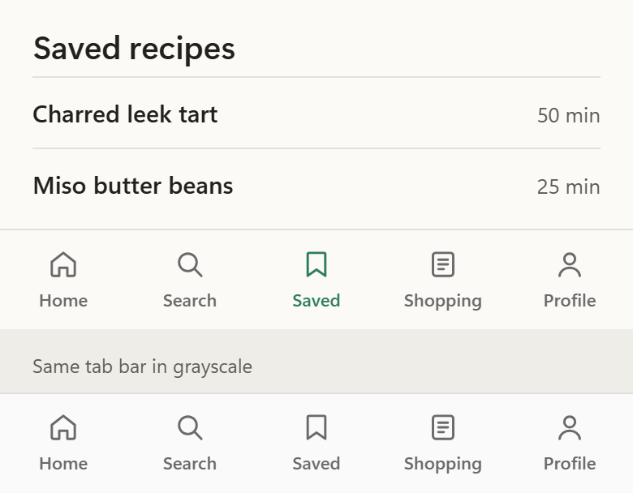
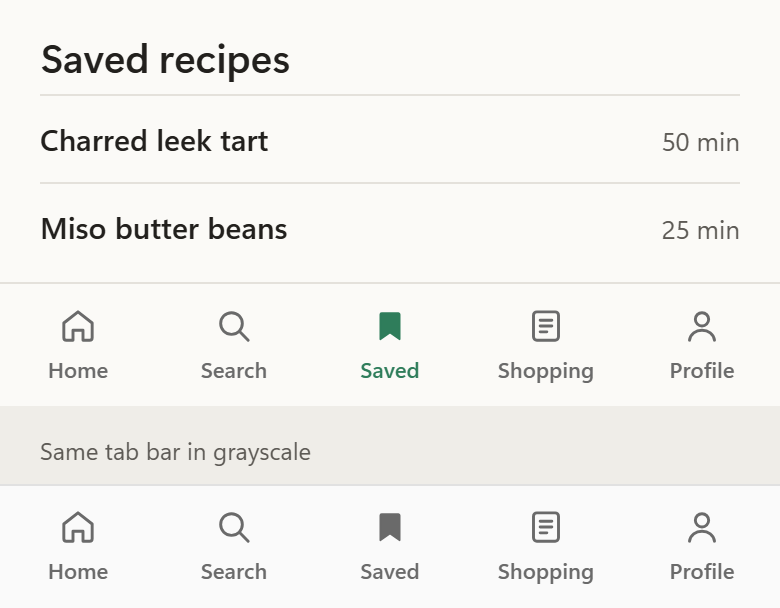

# Iconography System

Use this reference when selecting, extending or creating interface icons, pictograms, category symbols, feature graphics or a symbol family. Familiarity, visual fit, ownership and implementation cost are separate decisions.

## Decide Whether an Icon Helps

Start from role and context:

```text
role | intended meaning | audience/domain | placement | surrounding label |
frequency | state | target size | input/platform | accessibility owner
```

Prefer visible text when a symbol would be unfamiliar, ambiguous, rarely used, high-stakes or harder to scan than the label. Use an icon when it improves recognition, spatial economy, repeated scanning, direct manipulation, cross-language support or identity without hiding meaning. Decorative icons on every title, statistic, feature or card add nothing; illustrative symbols and interface controls have different jobs and may use different systems.

An icon and its backing are separate decisions: a clean path or valid metadata cannot justify a button-like surface behind a passive symbol. Apply the [backing check](quality-gates.md#icon-backings-and-nested-surfaces); a wrapper-only correction keeps the existing glyph and stays Direct when its answer and owner are bounded.

## Choose the Control Label Mode

Choose the presentation that makes the action quickest to understand and operate at its density, by action family, keeping peers consistent and justifying exceptions:

- **Icon only:** a recognizable, repeated utility whose meaning and state stay clear in its toolbar, view switcher or row before a tooltip appears.
- **Text only:** the wording carries the action, and a glyph would add no recognition, scanning or identity value.
- **Icon with text:** the pair materially helps recognition or scanning, or the action is unfamiliar, ambiguous or consequential enough to need visible wording.

Inspect the actual handler, outcome and neighbors before naming or hiding a label. A table/list view switcher can use familiar symbols with localized "Table view" / "List view" tooltips and a visible and programmatic selected state; an important commitment may need an action phrase. Keep accepted conventional controls, and never treat a passive service name, data label or form label as a redundant caption.

Own this reversible decision. When it is material and open, compare the credible modes in the real control set at actual size and input contexts, and select the clearest yourself. Judge icon-only recognition with the tooltip closed: hover help cannot rescue an unclear metaphor or serve touch users. Keep the wording while uncertainty remains. A known accepted pattern or a bounded caption fix needs no icon-source workshop or decision document.

Every icon-only action needs an accessible name independent of hover, such as the owning button's `aria-label` or `aria-labelledby`, with decorative SVG content hidden from assistive output. Reuse the site's tooltip component: concise help on hover and keyboard focus, readable while hovered, dismissed by Escape without moving focus or activating the action, and free of focusable controls. HTML `title` alone is not enough, and the name and description should not repeat each other. On touch, keep an understandable path without hover. See [button naming and state](https://www.w3.org/WAI/ARIA/apg/patterns/button/) and [hover/focus content](https://www.w3.org/WAI/WCAG22/Understanding/content-on-hover-or-focus.html). Verify recognition, accessible name and state, input behavior, target size and tooltip clipping at the affected viewport before presenting label removal as an improvement.

## Inspect the Existing Symbol Ecology

Before searching, inventory the current sources, exact glyphs, sizes, stroke and fill modes, optical weight, alignment, color behavior, labels and wrappers; platform expectations and repository-owned assets; which symbols are brand marks, actions, object or category symbols, status indicators, data glyphs or illustrations; semantic duplicates and misleading metaphors; and installed packages, versions, adapters, licenses, tree-shaking or font loading, and ownership. In an accepted system the established source is the baseline, not an automatic winner or a closed allowlist: keep it for routine actions that fit, and explore only where coverage, meaning, platform or art direction makes a material difference.

## Default Source

- **New or original design work** (Focused or Portfolio, a new identity): default to a custom family built with `glyph.py` in the product's drawing language ([icon-craft.md](icon-craft.md#build-a-family-with-glyphpy)). It keeps learned metaphors for familiar actions, redrawn in its tokens, and invents metaphors only for product-specific concepts.
- **Library fallback:** use one when the product needs more breadth than is worth drawing, or when the accepted system already uses one ([select it](#select-an-existing-source)).
- **Direct work in an accepted system** keeps the existing family; a new glyph extends it.
- **Third-party brand marks** stay official artwork.

## Resolve Identity Before Inventing a Metaphor

Establish what the symbol identifies from the actual label, destination, action and product facts, never from a service name or keyword list alone, and keep uncertainty explicit. A third-party identity is a source-fidelity decision; a product-specific mechanism is a metaphor and drawing decision.

For a third-party brand mark, look first in approved repository assets, then in the brand owner's current asset kit or a distribution whose exact artwork and terms can be checked against primary sources. Use the supplied symbol or wordmark in an approved color or monochrome variant, and keep its geometry, aspect ratio, clear space and required treatment: normalize the surrounding slot, never stretch, trace, simplify, tint or add effects to the mark. A generic arrow, ring, initials or hand-drawn approximation does not become the brand's icon. Custom preferences apply to the product's own symbols, not to replacement identities for external services.

Record the exact asset, source and variant, usage evidence and what was verified; a URL, library name or digest alone proves neither officialness nor permitted use. When a required asset cannot be verified, keep useful visible wording and leave that claim `UNKNOWN` rather than inventing an official-looking replacement. Known brand artwork needs no custom challenger; if a variant is genuinely open, compare official variants in their real hosts for recognition, contrast, native size, clear space, focus, selected and disabled treatment and inherited CSS that can recolor or distort the mark. The mark's identity is separate from the owning control's state, so brand colors need not join the monochrome action family. Developing an original identity for the user's own product is a separate, legitimate custom task.

## Choose Meaning Before Source

For each unresolved concept, build a small semantic set: the direct object or action; the mechanism or transformation; the output, consequence or state; a domain metaphor users already know; and visible text or no icon. Test each in its full label, neighboring actions, state and user vocabulary. Reject a clever symbol that becomes ambiguous without explanation, and use one glyph for one meaning per experience. Only then compare exact glyphs: `icon-concepts` results can prompt metaphors, while `icon-families` and `icon-candidates` are discovery snapshots, not current package or quality truth.

## Choose the Family Style

Decide outline, solid or duotone once per family and role, then apply it consistently. An accepted system or platform convention comes first: SF Symbols use `.fill` for the selected tab item; Material uses outlined icons at rest and filled icons for the selected navigation item; Fluent pairs Regular with Filled. When the style is open, start from these defaults:

| Role | Default style | Reason |
|---|---|---|
| Dense controls and icons beside text, 16–20 px | Outline, with stroke weight matched to the text's stems | Sits with type; a row of many stays calm |
| Selected, active or on state (current tab, favorite, toggle) | Solid version of the same glyph, plus the ARIA state | A change in mass signals state without a new metaphor |
| Very small (12–16 px), on photos or colored fills, status markers | Solid | Thin strokes break up or vanish |
| Feature, category and empty-state pictograms, 32 px and up | Solid or duotone | Mass reads as finished and owned at that size |
| Expressive or brand-led products where icons carry identity | Solid or duotone family | Matches the weight of display type and imagery |

Rules:
- Peers in one row share a style. A mixed row reads as a state difference, so mix styles only to express state.
- Solid glyphs look larger and heavier than outline ones. An outline/solid state pair keeps one outer edge so the swap never shifts (`glyph.py` builds it that way); solids that sit beside outline peers in another role go on a slightly smaller live area, or use the library's smaller optical size (Heroicons mini and micro, the Material `opsz` axis).
- In duotone, the primary layer alone carries the meaning; the secondary tone adds volume, never information. Use one secondary tone per family.
- A user's stated style preference is a requirement. "Looks premium" alone is not a reason; compare instead.
- When the style is open, render four unlike glyphs (simple, round, diagonal, dense) in outline, solid and duotone at real size, in default and selected states, then choose and record why. `icon_review.py` builds that sheet with `comparison_axis: "style"` and per-state assets ([cli-reference.md](cli-reference.md#compare-existing-custom-and-no-icon-candidates)).



**Color only:** every glyph is outline, so in the grayscale copy the selected Saved tab looks the same as its neighbors.



**Solid selected:** same colors, with a solid Saved bookmark among outline idle glyphs; the change in mass still marks the selection in grayscale. Both bars use 20 px glyphs, rendered at 2×.

Library variants to check against the installed package and version:
- Phosphor: thin to bold weights, fill, duotone.
- Material Symbols: variable `FILL` 0/1, `wght`, `GRAD` and `opsz` axes.
- Heroicons: 24 outline, 24 solid, 20 mini and 16 micro (solid).
- Tabler: outline plus many `…Filled` glyphs.
- Remix Icon: line and fill.
- Fluent UI System Icons: Regular and Filled at several sizes.
- SF Symbols: `.fill` variants with hierarchical and palette rendering.
- Lucide: outline only. Pair it with a solid family or custom solids when selected states need mass.

`glyph.py` derives solid and duotone forms from the outline construction and validates them ([icon-craft.md](icon-craft.md#build-a-family-with-glyphpy)); validate hand-drawn ones in `fill` or `duotone` mode.

## Select an Existing Source

Rank exact candidates on recognition in context; optical size, weight, density, baseline, perspective, terminals, corners and negative space beside the real UI; state and variant coverage; platform and brand fit; accessibility and localization; and current official availability, license, maintenance, adapter, payload and repository compatibility. Render finalists at target size beside real neighbors before dependency economics break a semantic or visual tie, without installing the whole comparison set. When build work justifies an external winner, verify its official source and license, install only the selected adapter with the repository's package manager, and update the lockfile; review-only work authorizes no dependency change. Several sources can coexist only with an explicit role boundary and compatible rendering; normalize size and wrappers, never distort paths until incompatible drawings look uniformly mediocre.

## Develop Custom Candidates Where They Add Value

For an open product-specific feature, category, service or repeated family, and whenever the user prefers custom work, sketch a custom candidate instead of stopping at an approximate library match, then finish it with [icon-craft.md](icon-craft.md). An explicit request for custom icons puts drawing in scope without further asking. The preference changes what to explore, not the quality bar, and adds no icons where text works.

Inside an accepted library family, custom work is justified when the product has an object, mechanism, category or brand behavior no existing symbol expresses clearly; when a small signature family materially strengthens identity or comprehension; when platform templates support a coherent extension; or when licensing, language, state or technical constraints rule out available sources. "Feels premium", "a generator can make SVG" or "the library is imperfect" is not a justification. Keep the learned metaphor for Home, close, search, back and similar actions: a custom family redraws their familiar silhouette in its tokens without inventing a new meaning, an accepted system keeps its glyphs unless the user opens them, and a bounded correction to an accepted glyph does not reopen its source.

Before paths, inspect the feature's real input, action or object, outcome, state, label, nearest sibling meanings and smallest slot, and write a brief: `this symbol represents …; it must not imply …; it sits beside … at … CSS px`. Leave an unknown mechanism unresolved instead of inventing a capability. Pick a dominant silhouette and the minimum modifier that changes the meaning, and test alternative constructions only while the metaphor is open. Generic sparkles, shields, crowns, gears and crossed tools fit any feature; a shield-check asserts safety or completion and a download arrow turns a history view into an action, so verify such implications against the actual state.

Draw editable SVG geometry or extend the established vector system; raster generation suits only genuine raster illustration roles. Compare the custom candidate with the strongest existing or text alternative at equal size in the same host. Prefer custom when recognition, accessibility and rendering are at least as strong and its metaphor or family fit is visibly more specific; it need not be unprecedented or beat every library. Once the construction works, propagate its grammar to the family and inspect the whole set. A library asset reused unchanged stays existing; call an adaptation derived and keep its license and provenance. Ownership is not a quality claim.

## Specify the Drawing Language

Write a family specification before drawing; a `glyph.py` spec records its geometric half (grid, live area, keylines, stroke, caps, joins, corners, detail density, tone), and the rest stays beside it:

```text
family role and semantic range
coordinate grid, live area, key lines, and optical overshoot
target sizes and smallest detail
stroke / fill / mixed / duotone mode, secondary tone and weight variants
cap, join, terminal, corner, and taper behavior
primitive shapes, curvature, diagonals, and perspective
positive / negative-space rhythm and counters
baseline, visual center, and center-of-mass rules
detail budget and simplification by size
state, badge, directional, mirrored, and animation variants
color/currentColor and theme behavior
accessibility ownership, provenance, license, and maintainer
```

The grid is a construction aid, not the optical result: curves overshoot, asymmetric subjects need asymmetric padding, and diagonals and circles need visual compensation, so equal numeric boxes do not guarantee equal perceived size. Establish the grid and stroke or fill language around the smallest implemented size (16, 20 and 24 px for ordinary interface icons unless the component documents another set), and make deliberate optical variants where a detailed large drawing would scale into illegibility. When a change introduces or materially extends a family, prove it on unlike subjects (one simple orthogonal, one circular, one diagonal or asymmetric, one dense domain icon) before polishing a single favorable symbol; a single bounded correction compares against established neighbors and the strongest exact alternative instead.

When an icon looks weak, muddy or pixelated, reproduce it at the user's actual size, scale and background. Separate a raster source or upscaled screenshot from vector geometry, host resampling and ordinary antialiasing, and keep the original asset and capture conditions. Judge sharpness from a lossless, unresized capture or the live renderer with CSS size and DPR recorded: JPEG compression, thumbnails and enlarged chat previews add artifacts, and a sharper capture is better evidence, not a better icon. When the source is sound but the host is soft, fix the owner's width and height, fractional translation or scale, flex shrink, CSS filter, bitmap delivery or resampling, checking the relevant DPR and zoom; integer coordinates, disabled antialiasing, `crispEdges` on curves, sharpening or raster upscaling are not universal repairs. Drawing repairs belong to [icon-craft.md](icon-craft.md#make-the-drawing-intentional).

## SVG Contract

For interface SVGs: declare a stable `viewBox` without unexplained transforms or fractional drift; paint with `currentColor` or documented semantic roles unless multicolor carries meaning; keep inline text, scripts, embedded remote images and external references out; prefer simple geometry to masks, filters and clipping; let the owning component provide the accessible name and hide decorative duplicates; and keep editable source or construction parameters when optical variants are expected. Validate structure and provenance with `asset_quality.py`, using the `interface-icon` profile for original drawings and the `brand-mark` profile for unchanged imported brand artwork ([validator](cli-reference.md#validate-custom-svg-structure)). A passing validator proves only the declared structural contract, never beauty, recognition, optical balance or family coherence; never rewrite a brand mark to obtain a PASS.

## Compare Candidates

When the outcome is genuinely open, compare only the strongest plausible existing, custom and visible-text or no-icon alternatives; a familiar routine action in an accepted family stays Direct, with no manufactured challengers. For a material decision, `icon_review.py` builds a representative-control matrix from validated, digest-bound candidates and their contexts ([manifest rules](cli-reference.md#compare-existing-custom-and-no-icon-candidates)); it supports like-for-like size and state comparison but does not replace the host component.

Inspect the matrix at wide and narrow viewports, then claimed winners and close losers in the real UI at every implemented size and the relevant default, focus, selected, disabled, light, dark and high-contrast states. Record four evidence categories separately:

- deterministic contract: SVG, metadata and manifest structure, exact byte bindings, source and license bindings, and comparison-to-host state coverage;
- rendered or browser regression: what the sheet and host component actually render;
- current source evidence: official asset bytes, version and license for external assets, which stay unverified until primary-source review;
- human visual judgment: recognition, silhouette, optical center, weight, negative space, metaphor and neighboring fit.

The [icon-decisions proof](https://github.com/What0ff/snowe-ui-skill/tree/main/evals/icon-decisions) in the source repository (not part of an installed skill) shows all three legitimate outcomes: an existing glyph wins and custom is rejected, custom wins for a product-specific mechanism, and visible text with no icon wins because an icon would assert the wrong state.

## Recognizability and Optical Review

Use short-context checks, not a popularity vote:

- Can a representative user tell the icon from its nearest semantic neighbors?
- Do label and icon reinforce one meaning?
- Which details disappear or merge at target size?
- Does it look the same size and weight as its neighbors without measuring larger?
- Are the baseline and visual center right in the real control?
- Do curves, diagonals, counters, terminals and corners feel drawn by one hand?
- Does the selected or filled treatment change emphasis only, not meaning?
- Does mirroring preserve meaning across directionality, or is the symbol culturally or spatially fixed?

Mark custom work `REJECT` when recognition, ambiguity, balance, detail survival, state clarity or family coherence is worse than the best existing or text alternative. Record the loser; keep nothing because it is ownable or took effort.

## Accept the Context, Not the Drawing Sheet

A selected custom asset stays an unverified draft until its actual slot, neighboring label, backing and required compact states are inspected; bind whole-context and detail captures through [browser observation](cli-reference.md#observe-in-a-browser) for reusable acceptance and apply the [detail sweep](quality-gates.md#detail-and-artifact-acceptance). A malformed join, stray sliver or doubled stroke is a visual finding even when XML and bounding-box checks pass. For a new or materially revised custom symbol, close each applicable claim in the existing finding record:

| Claim | Required evidence and failure disposition |
| --- | --- |
| Context and truth | Compare the label/action/state with the metaphor and its nearest sibling meanings. `REJECT` a false capability, premature status, misleading action, or semantic collision; a polished shape cannot compensate. A self-review is not a representative-user recognition study. |
| Small-size recognition | Inspect every implemented size at native display scale, first for silhouette and then detail. `REVISE` merged strokes, lost distinguishing cues, muddy diagonals, crowded counters or ambiguous composites; simplify or redraw and rerender. |
| Optical family fit | Compare unlike neighboring glyphs in their real rows/controls, including the densest and most asymmetric required symbol. `REVISE` inconsistent apparent weight, baseline, size or rhythm. Equal viewBoxes and stroke numbers are not proof. |
| Host and backing | Inspect the actual owner, surrounding label, painted backing and affected states. Fix host scaling/shrinking and unjustified surfaces independently; use the [backing check](quality-gates.md#icon-backings-and-nested-surfaces). A contact sheet does not certify host rendering. |
| Technical and accessible behavior | Validate the changed SVG/metadata, then verify accessible ownership, color inheritance, clipping and relevant themes/focus/disabled/forced-color states. Fix applicable failures before acceptance; distinguish asset integrity from interaction proof. |
| Fresh proof | Bind findings to exact asset bytes and the current host/state/viewport. Missing or stale required context stays `UNKNOWN`; screenshots created but not inspected cannot close the claim. |

Accept at native size; an enlarged crop only diagnoses geometry. When small-size softness is at issue, compare DPR 1 with an available higher-density render and record actual browser metrics, inspecting fractional scale only where it is used; never invent device coverage. Judge icon-only ambiguity without the author's explanation, then restore the real label: a labelled domain icon need not stand alone universally, but must not contradict its label. Repair semantics before paths, paths before optical alignment, and host paint and scaling at its owner. Compare the improved candidate with the same baseline, keep rejected evidence, and stop when the applicable claims pass. If the custom candidate still loses, use the better existing or text outcome and record the limiting cause; an unverified custom draft never counts as an accepted icon.

## Delivery

Report semantic decisions, the established ecology, exact finalists, current source and license evidence, family role boundaries, the custom family specification when used, target-size context renders, validator output, accessibility ownership, rejected candidates and unresolved symbols. SVG validity alone never shows that a family is coherent.
