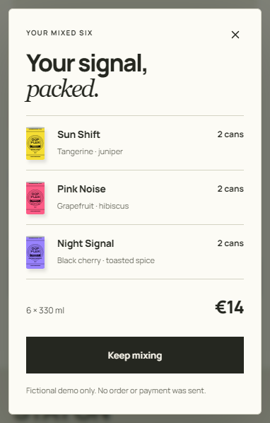
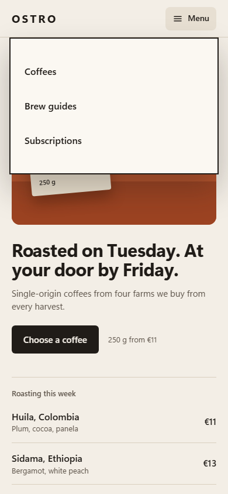
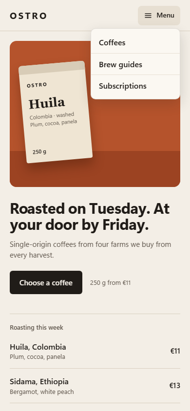

# Design secondary surfaces: menus, modals and selection

Read when a menu, select, combobox, popover, dialog, drawer, sheet or tooltip is introduced, rejected or materially changed. Inspect the real open owner with its portal, theme and scroll container; a finished trigger does not certify what it opens, and Direct work stays with one known owner and its relevant states. Each secondary surface is an authored composition with clear attention, deliberate type and material and finished controls; framework defaults and loosely padded gray boxes are unfinished work, and working interaction is evidence, not the visual result.

## Compose a modal rather than filling a template

Start from the question the surface resolves and what must be seen together, then let type, grouping, width and material carry that order: a confirmation leads with its result and object, an edit task with its field relationships, a consequential decision with its consequences. Match the title to the task (a utility dialog needs no campaign heading). Header, content and actions form one composition, with the title near its object, useful subordinate facts kept, and the footer inside the same surface. A quiet dismissal and one named continuation beat two competing primary buttons.

Backdrop, panel fill, edge, shadow and corners describe one layering model; judge how much of the page stays legible and whether its strongest masses compete, since more blur, border, radius or gray is not refinement. Carry the site's type voice and icon grammar into the layer at the task's scale. Inspect the close control at native size (hit region, weight, optical center, contrast, hover, focus), keep imagery truthful and subordinate, and give long content or enlarged text a reachable scroll path.

A bounded editorial title, three aligned product and quantity rows, a quiet total and one continuation, in the campaign's paper, edge, backdrop and close glyph: one small composition rather than separately styled controls. An expert tool can be as strong with a denser, plainer title; copy the relationships, not this typography.

## Choose the interaction before its shell

Navigation, a command menu, single or multiple choice, a searchable combobox, a picker and a modal task have different grouping, selection and keyboard contracts. Default: a compact anchored surface for a short command list, a bounded list with persistent search for a long choice, a sheet for a narrow touch task; native selection stays legitimate. Keep the established component when it preserves semantics, since a prettier div list that loses keyboard selection, naming or value is a regression. When a native popup cannot be inspected, name that missing proof.

## Make the trigger and surface one system

Trace trigger → mount owner → rows → selected, active and focus states → tokens → consumers. Portals escape the ancestor that supplies font, theme, density and z-index, so verify computed type, colors, separators, radius, shadow and focus at the portal root.

Size width from content and the trigger relationship: a value list may align with its field, and a short menu never stretches across a header for convenience ([incident](failure-patterns.md#a-short-menu-stretched-across-a-tablet-header)). Keep long values, localized labels and useful secondary text: trigger width, readable option extent and viewport limit are separate constraints, so allow wrapping or justified truncation with the full value accessible. Choose the coordinate space explicitly (local owner, or projected viewport bounds for a fixed portal), never applying scroll offsets twice or using a transformed screen box as a local dimension ([incident](failure-patterns.md#a-detached-looking-lid-on-a-rotated-3d-can)). Check zoom, nested scroll, sticky headers and transformed ancestors; flip or shift only when space requires it, without jumps during keyboard movement.

## Craft the open anatomy

- Give rows deliberate proportions and align visible icon mass with text baselines; finish custom glyphs in the row with [icon-craft.md](icon-craft.md).
- Separate groups with a small interval or quiet rule. Options get no individual cards, headings or wells; a header or footer earns space only for search, orientation, commitment or recovery.
- Keep selected, keyboard-active, hover, pressed and disabled distinguishable: hover is not selection, and a chosen value survives focus moving away. A check, weight or shape cue can support color; unrelated badges cannot.
- Resolve fill, edge, shadow and corners against the real substrate: a heavy border and large shadow can overpower a quiet page, a faint surface can vanish into a table.
- Keep focus paint readable against the surface it touches; on-color option text does not make a good outer ring ([incident](failure-patterns.md#a-focus-ring-that-vanished-beside-a-dark-button)). Check clipping at padding, corners and scroll edges.
- Bound long lists at the actual scroll owner with search and actions reachable, the selected option visible and the last row reachable by wheel, touch and keyboard. Never hide options to tidy a screenshot.

## Compare a weak shell with a resolved one

Both images show the same page, open trigger and three items; only the open surface changes.

A three-item list spans the screen, spends its space on padding and a heavy frame, and leaves its items far from the Menu trigger. Fitting the viewport does not make it intentional.

The panel fits its content, hangs from the Menu owner, keeps consistent rows and a quieter edge, sits over an empty corner of the hero and leaves the wordmark clear. It is an example, not a width or radius preset: a long searchable list or touch task can rightly use a wider sheet.

## Verify the state, then judge its finish

Use independent postconditions (expanded trigger, visible options and value, selected state, focus, outcome after activation); a click on a moving or covered target can leave the popup closed under an "open" label, which the [observation contract](cli-reference.md#observe-in-a-browser) catches. Inspect open and closed, hover, focus, selected, disabled and the content pressures the component really has (long labels, groups, empty, loading, error, long lists) at the relevant theme, width, zoom and viewport edge, and repeats only where they share the owner, not every theoretical state.

Verify Escape and outside-click close with focus return, commit and cancel, Tab and arrow keys and scroll ownership; a nonmodal menu gets no focus trap. Opening motion shows origin and settles fast enough for repeated use, reduced motion shows usable content at once, and a campaign's product motion stays out of routine option navigation.

`KEEP` needs a surface that looks deliberate whole and at native row detail: balanced extent, coherent type and material, clean rhythm, clear states, optical glyph fit and readable layering. A raw generic shell is `REJECT` even when every option works. Record cause, one controlled change, a comparable rerender and collateral checks; supplied designs and justified exceptions stay, and a small popup repair does not reopen the product identity.
