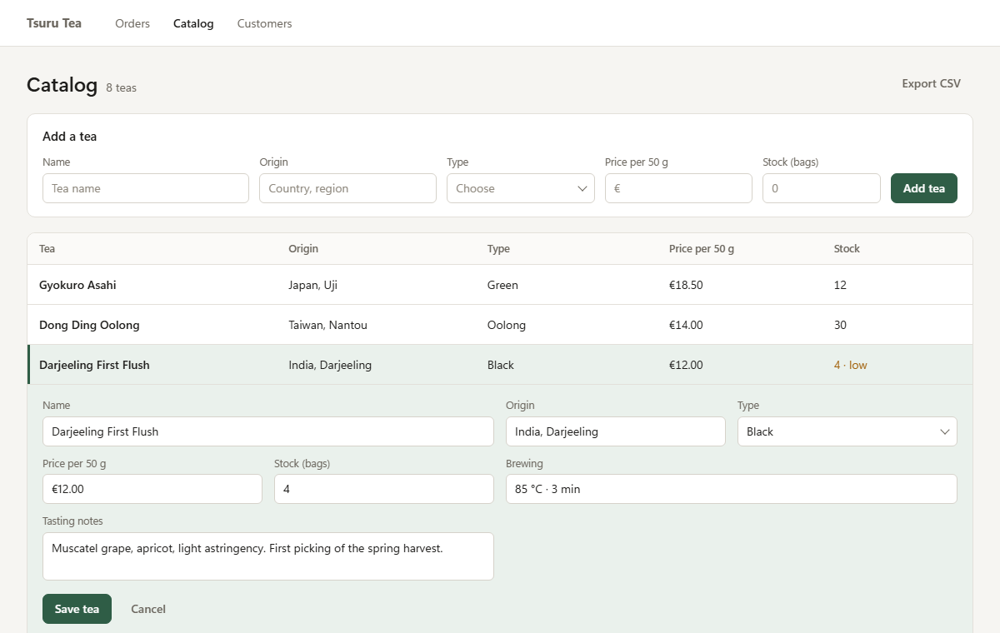
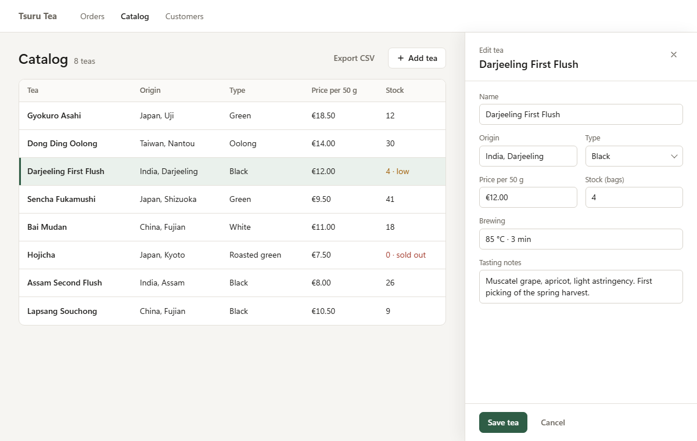

# Choose Surfaces and Disclosure

Use when a page or app has secondary tasks, item details, settings, confirmations, feedback or reference material, and whenever a page map is open. Decide where each group lives before choosing components or styling. A finished secondary surface is designed with [overlays-and-selection.md](overlays-and-selection.md); this reference decides whether that surface should exist.

## Allocate Each Group

Add a `surface` column to the page map in [page-hierarchy.md](page-hierarchy.md): every group and operation gets one home. Start from this table, then adjust to the observed task.

| Content or task | Default surface | Choose differently when |
|---|---|---|
| The primary task and the data it needs now | Main surface, always visible | Never hide it behind a click |
| Details of one item while its list stays relevant (inspect, quick edit) | Side panel or inspector beside the list | The edit is long, multi-step or worth linking: its own route. Narrow screens: full-screen sheet or route |
| Short focused task that must finish or be cancelled before work continues (create with a few fields, confirm a destructive or fee-bearing action, resolve a conflict) | Modal dialog | The user needs to read the page behind it: side panel. It grows long: route |
| Small contextual choice or help anchored to a control (sort, filter values, date, quick actions, definitions) | Popover or menu at the control | It holds a real form or must stay open while working: panel |
| Peer views of one object (overview, activity, settings) | Tabs | The views must be compared at once: show them together |
| Occasional detail inside a section (advanced options, full history, terms) | Disclosure in place (expand or accordion) | People need it on most visits: keep it visible |
| Long, multi-step, shareable or resumable work (checkout, onboarding, a settings area) | Its own page or route, with steps when order matters | It is two fields: dialog or inline |
| Feedback | Result visible in place: inline change. Effect not visible: toast with undo. Ongoing system condition: banner. Failure that needs a decision: dialog | Errors about a field stay at that field |

On narrow screens, transform rather than shrink: a side panel becomes a full-screen sheet or route, a popover becomes a bottom sheet, and a form dialog becomes full screen.

## Balance Both Directions

Neither "show everything" nor "hide everything" is free. Record the reason for each surface the way you record any other material decision.

Signs of an overloaded main surface:
- forms for rare tasks are permanently open;
- several primary actions compete;
- the main work starts below the first screen;
- settings and reference text sit between the data and its actions.

Signs of over-hiding:
- a frequent action takes two or more steps;
- information needed for a decision sits behind hover or another tab;
- a dialog needs information from the page it covers;
- a dialog opens another dialog.

The main surface holds what the current decision needs. Everything else is one visible step away, with its trigger next to the object it affects.

**Crammed:** the inline edit form pushes five of the eight teas below the fold, and the rarely used Add a tea form stays open with a second filled button.

**Allocated:** the same fields open in a side panel beside the list, so all eight teas stay visible with the edited row marked, and adding a tea is one button away.

## Keep Context and Control

- Opening a detail keeps the list position, filters, selection and entered data. Closing returns focus to the trigger.
- One modal layer at a time. Replace content inside the same surface, or use steps, instead of stacking dialogs.
- A confirmation states the consequence: what will be deleted, the fee and its amount, what cannot be undone. Name the action on its button ("Cancel appointment", not "OK").
- A failed save inside a surface keeps the surface open, keeps the input and shows recovery there.
- A selection worth sharing or reloading (open item, active tab) lives in the URL.

## Implement

- Modal: native `<dialog>` with `showModal()`. Escape closes it, focus lands on the first meaningful control, the page behind is inert, and focus returns to the trigger.
- Nonmodal popover or menu: the `popover` attribute or an equivalent with correct roles, anchored to its trigger, dismissed by Escape and outside click.
- Side panel: nonmodal by default (the page stays usable), with its own heading and close control. Make it modal only when the page behind must not change.
- Give each surface type a stable size: a fixed width per type and internal scrolling, while the header and actions stay visible. See [stable geometry](design-foundations.md#stable-geometry-across-states).

## Check

Walk every secondary task:
1. Its trigger is visible near what it affects.
2. The surface matches the table above or has a recorded reason.
3. Context survives opening, closing and failure.
4. The narrow-width transformation works.

Render the main state, at least one open secondary surface, and that surface at the narrow width.
