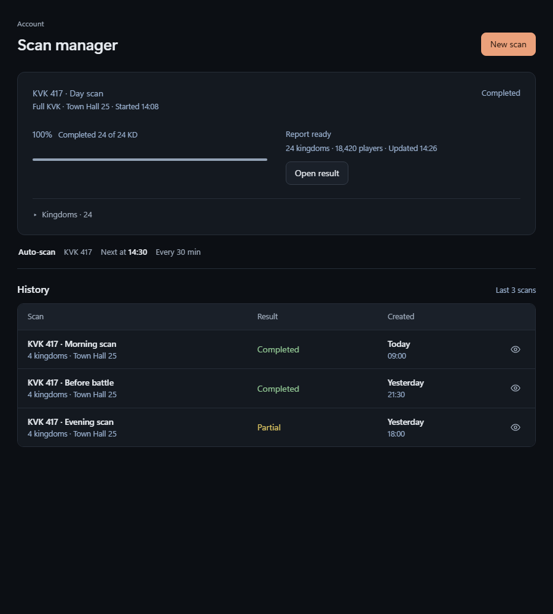
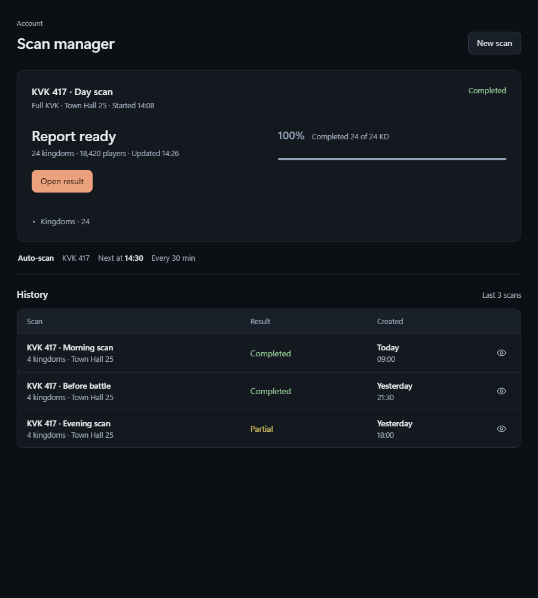
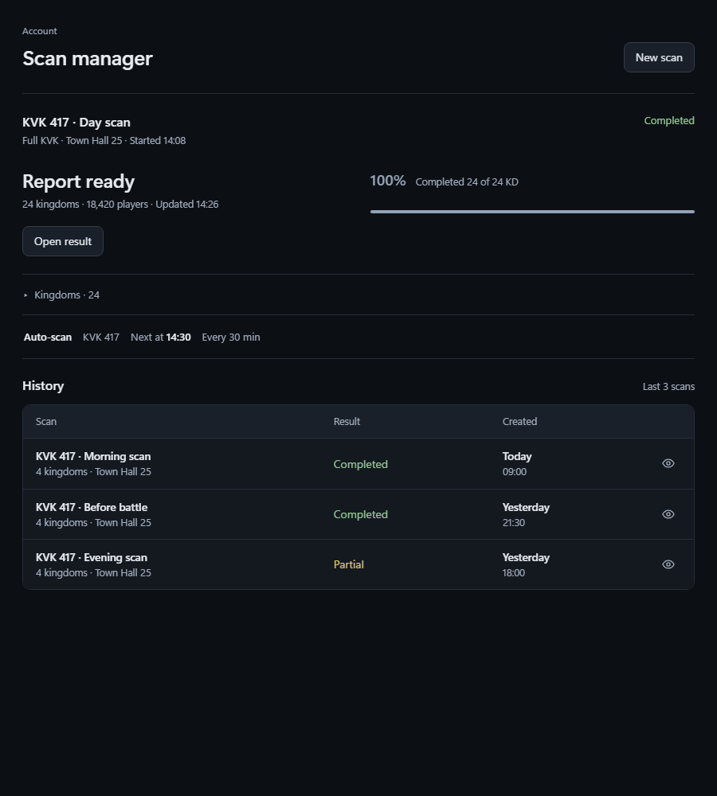

# Reason from visible relationships

Read for an open composition, an unfinished visual direction, or a repair whose perceptual cause is unclear. The images below teach relationships, not a style; each pair uses the same content and viewport, and their judgments are implementer self-review, not gaze research.

## Weak and stronger: redirect attention by state

The warm **New scan** button is the only large chromatic mass, so it pulls the eye before the current result. A long progress bar gives a finished process more area than its outcome, the result sits small and apart on the right, and uniform small blue metadata flattens role contrast. Nothing is broken; the hierarchy is simply weak.

The result moves to the start of the reading column as a heading and takes the warm fill for its action, which appears nowhere else; New scan becomes subordinate, progress turns neutral and Completed keeps the history rows' green. Heading, count and action form one proximity group closed by a divider, and the table keeps its compact rows.

**Mechanism:** move contrast, scale, area and proximity toward the current question. **Prediction:** the completed result reads before a new operation, without deleting progress or history. **Counterexample:** while a scan runs, progress can lead, and a destructive next action never earns prominence for coming next. Rerender running and error states after such a repair; they need different emphasis.

## Two good answers with different strengths

A bounded surface groups the current run and color marks the next action. It suits occasional users, competing tasks and a clear move from monitoring to result; repeated many times, its surface and color weight can become excessive.

Type, position and rules hold the same result-first order without the outer surface, so the current item joins a continuous reading field. It suits frequent expert scanning or an accepted restrained system, but its outlined action captures unfamiliar users less. Fewer effects do not make it superior.

Choose from the task, accepted identity and surrounding composition. The shared invariant is result-first grouping in the completed state, not orange buttons, one panel, a dark theme or a density.

## Translate an impression into a falsifiable proposition

| Desired perception | Candidate moves and perceptual mechanism | Evidence and useful counterexample |
| --- | --- | --- |
| Confident | A decisive scale relationship, a few stable alignment axes, deliberate rather than accidental negative space | Read the silhouette at thumbnail size, then inspect real text. A dense expert tool may express confidence through consistency and precision rather than a huge headline. |
| Energetic | An asymmetric mass balance, controlled diagonal, a concentrated chromatic field, an event with acceleration and release | Check that the product/action still wins at native size. Continuous motion in a monitoring task can destroy the intended clarity. |
| Calm | Predictable grouping, quiet secondary contrast, measured line lengths and stable state geometry | Inspect errors and long labels. Pale low-contrast text and empty giant wells do not create useful calm. |
| Crafted | Optical rather than merely geometric alignment, careful joins/crops, consistent typographic color, restrained material detail | Compare label/control baselines and actual glyph mass. A supplied deliberately rough reference can call for a different finish. |
| Rich | Relationships of warm/cool, lightness, chroma and painted area; believable image/material lighting | View the whole screen in color and inspect compositing. Tinting every surface may remove depth or impose the wrong identity. |

These are hypotheses: state the intended effect, build a coherent candidate, render it, and keep or reject it on the observed consequence. A justified exception can be the central invention.

## Diagnose whole and detail together

At thumbnail scale, find the dominant masses and the route between them: does an empty panel outweigh useful content, do similar rectangles falsely imply equal status, is a focal event balanced by a quieter region? Then check at native size that hierarchy does not depend on illegible small copy, and return to the whole after every local repair.

Use proximity and common region for related facts, similarity for real peers, continuity to lead through related operations, and figure and ground to separate working content from an overlay, without stacking card, rule, shadow and color on one relationship. Negative space is an active interval: judge its cumulative rhythm, not each padding value.

Check optical alignment at visible edges and baselines: a triangular arrow or uneven word has a different center of mass from its box, so compare a small deliberate offset with the geometric baseline at real size while keeping the hit region. Headline breaks carry meaning and shape; an orphaned article, accidental last word or repeated line ending weakens a good scale. Measure with the settled font at pressure widths and the required scripts.

Color weight depends on area and neighbors: a small vivid action and a full vivid panel are different propositions, so judge hue, chroma, lightness and area separately. For translucency, inspect the real substrate, stacking, blend, texture and light; an opaque contrast calculation does not resolve a composited surface. Image crop, gaze and empty image regions join the same mass and alignment system as text, and motion changes that system over time: inspect anticipation, peak, interruption and the final state, not only the best frame.

## Repair as an experiment, then remember conditionally

Keep a compact chain: **observation → plausible cause → one relational change → expected consequence → comparable rerender → collateral checks → disposition**. If the action is lost, test its grouping or contrast against the result first, not font, palette, spacing and copy at once, and compare on identical content; a redesign that changes content is no longer an isolated test of treatment.

Keep rejected repairs with reasons: a larger button may restore attention but break proportion and crowd the mobile line; removing a backing may quiet the page but erase selection. A supported lesson records where it applies, a counterexample and bound before/after evidence ([hypothesis record](cli-reference.md#version-a-visual-system-contract)); "this decorative disk competed with these labels" never becomes "remove all round shapes". A small material artifact can undo a strong composition: see the [recorded incidents](failure-patterns.md#recorded-incidents).
